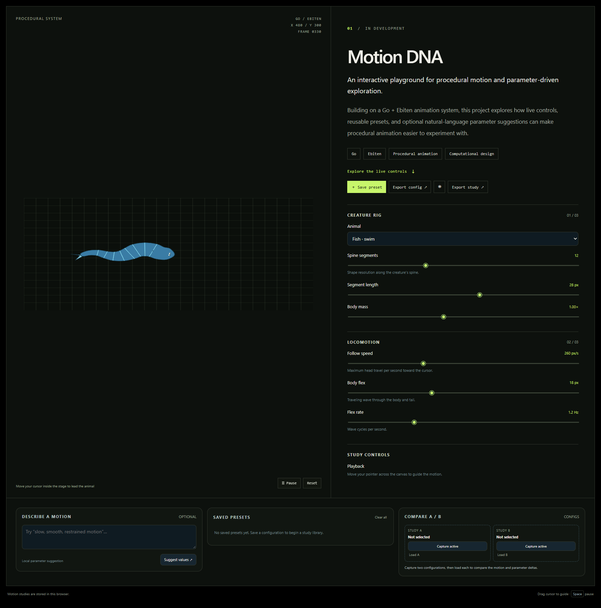
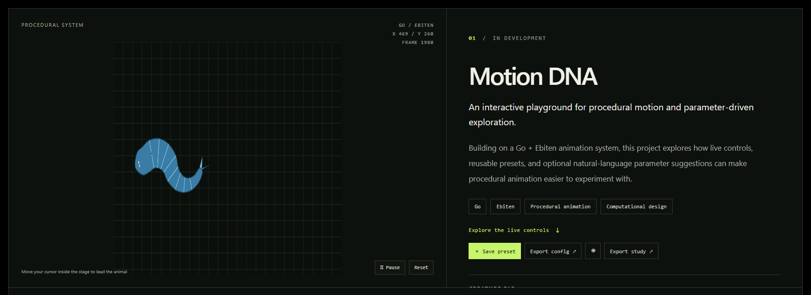
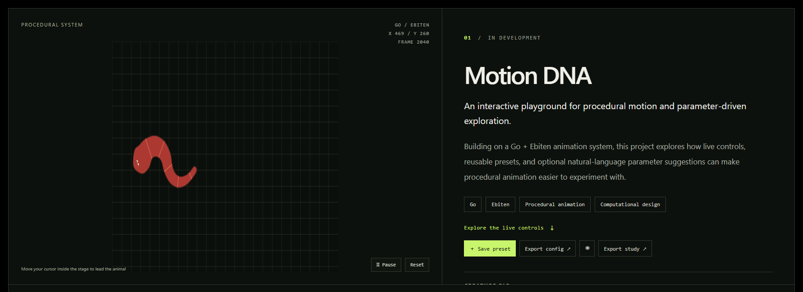
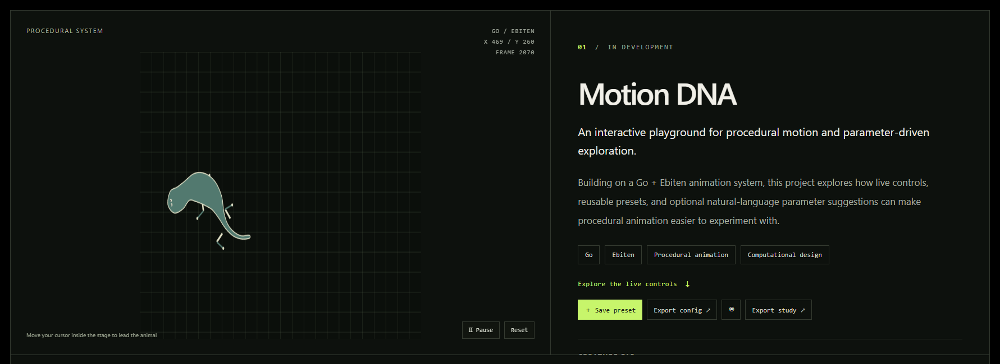
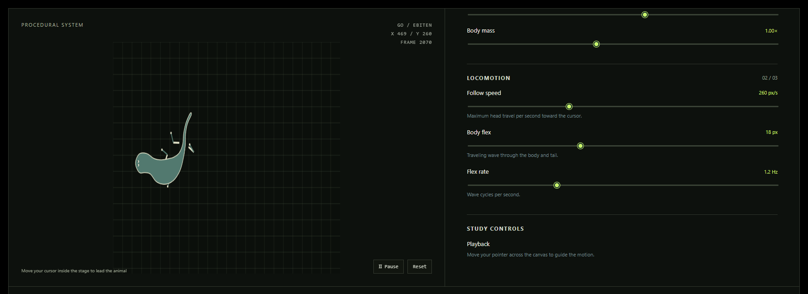

# Motion DNA

Motion DNA is a small browser based procedural animation lab built with Go, Ebiten, and WebAssembly. Edit the controls while the simulation runs, move the pointer inside the stage to lead the creature, and save or export configurations from the right rail.

## Screenshots

The screenshots below show the Motion DNA workspace and its available creature rigs.



*The full workspace combines the rig selector, live animation stage, controls, and preset/export tools.*

| Fish rig | Snake rig | Lizard rig |
| --- | --- | --- |
|  |  |  |
| A streamlined fish-style chain following the pointer. | A flexible snake-style chain with flowing motion. | A segmented lizard-style rig with articulated movement. |



*The controls view highlights the live parameters used to tune spine resolution, segment length, mass, follow speed, and flex.*

## Run locally on Windows

With Go installed, run this from PowerShell:

```powershell
.\run-web.ps1
```

Then open <http://localhost:8000>. The script builds `game.wasm`, copies Go's `wasm_exec.js` runtime into the project, and serves only the three browser assets. Press Ctrl+C in the terminal to stop the server.

You can also run it manually:

```powershell
$env:GOOS = 'js'
$env:GOARCH = 'wasm'
go build -o game.wasm .
$goroot = go env GOROOT
Copy-Item (Join-Path $goroot 'lib\wasm\wasm_exec.js') .\wasm_exec.js
Remove-Item Env:GOOS
Remove-Item Env:GOARCH
go run .\cmd\serve
```

## Controls

- Select a fish, snake, or lizard rig in the left panel. Chain and point modes show the underlying constraint primitives.
- Adjust spine resolution, segment length, body mass, follow speed, flex, and flex rate. Changes are sent to the simulation as you move each control.
- Move the pointer inside the canvas stage to lead the animal. Use Pause to freeze the procedural motion.
- Save presets locally, capture A/B configurations, and export PNG frames plus JSON study settings.
- The motion description helper applies local rule based suggestions; it does not call an AI service.

The animal rigs are inspired by argonaut's [procedural animation video](https://youtu.be/qlfh_rv6khY) and [reference implementation](https://github.com/argonautcode/animal-proc-anim).
